# 🏡 山居里｜民宿预订与运营管理系统

> **毕业设计项目** · 面向单民宿的预订、接待、房务、财务与 AI 咨询系统<br>
> 一套系统连接顾客预订、管理员运营和保洁任务，业务数据由 Java 服务端统一校验。

<p align="center">
  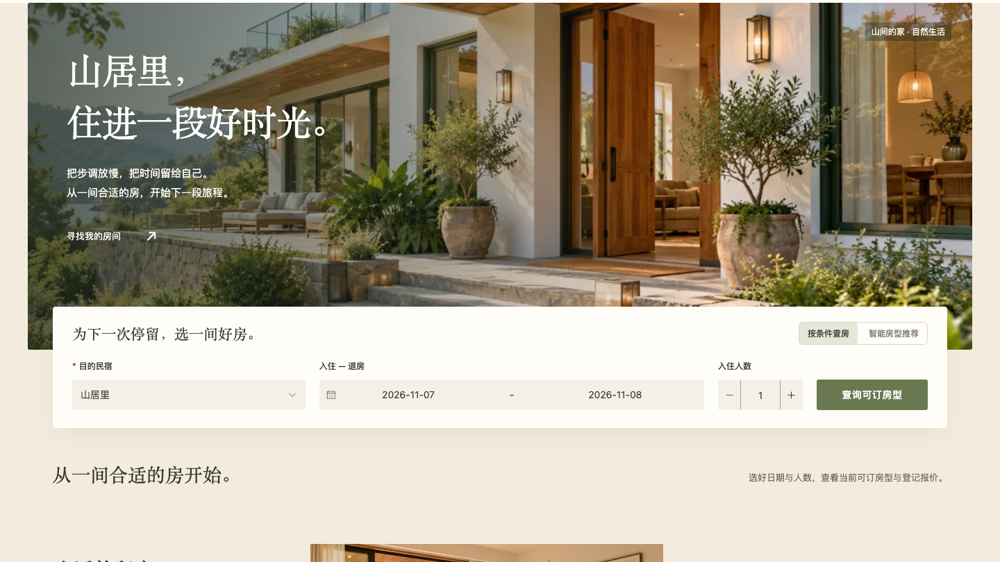
</p>

<p align="center">
  <strong>◆ 顾客预订</strong>　→　<strong>◆ 接待与运营</strong>　→　<strong>◆ 房务协作</strong>　→　<strong>◆ AI 辅助咨询</strong>
</p>

<p align="center">
  
  
  
  
  
  
  
</p>

## ✦ 项目概况

山居里 V1 是一套以真实住宿业务流程为核心的单民宿管理系统。项目采用前后端分离结构，覆盖顾客在线查房与下单、管理员订单及经营管理、保洁任务处理，并提供住宿客服和经营助手两个 AI 入口。

| 项目项 | 说明 |
| --- | --- |
| 项目定位 | 本地毕业设计与演示系统，不是商业 SaaS |
| 业务范围 | 单民宿 `HOTEL_ID=1`：山居里 |
| 用户角色 | `ADMIN` 管理员、`CUSTOMER` 顾客、`HOUSEKEEPER` 保洁 |
| 订单编号 | `SJ` + 8 位随机字符；数据库内部仍使用原主键 |
| 数据库 | MySQL，业务库名 `shanjuli_final` |
| AI 运行时 | 唯一 LangGraph4j Runtime，按服务端角色进入不同场景 |

## 🧭 功能一览

| 角色 | 主要功能 |
| --- | --- |
| 🧳 **顾客** | 查找可订房型、查看房型详情与报价、创建及管理本人订单、维护个人资料、联系民宿、使用住宿 AI 客服 |
| 👑 **管理员** | 经营概览、预订管理、房态日历、入住与退房、调房、房型和客房、顾客档案、资金流水与结算、清洁及维修、知识库、人工消息、AI 设置与经营助手 |
| 🧹 **保洁** | 查看本人任务、开始清洁、完成任务、浏览本人任务记录；无权访问顾客、资金、人工消息及 AI 管理数据 |

### 核心业务流程

```text
顾客查房 → 服务端报价与库存校验 → 创建订单（SJ 短编号）
    → 管理员确认及办理入住 → 登记收付款 → 退房结算
    → 自动生成清洁任务 → 保洁完成 → 房间重新进入可售状态
```

- **房态与库存**：按入住日包含、退房日不包含的日期区间查询，并综合订单、维修及房间状态。
- **订单可靠性**：服务端重新报价，订单创建保留幂等、库存锁、状态流转与 revision 校验。
- **财务口径**：以已登记收退款流水和结算记录为准；登记数据不等同于真实支付，也不代表利润。
- **人工消息**：顾客与管理员之间的独立站内消息；AI 不读取、不发送人工消息。

## 🖼️ 界面截图

以下为项目此前开发与验收记录中的真实 Playwright 页面截图。截图用于展示界面，不代表本轮重新运行结果；其中的日期、金额和记录为当时页面内容，不代表当前经营状态。

### 🧳 顾客端

<p align="center"></p>

| 查房结果 | 房型详情与预订确认 |
| --- | --- |
| 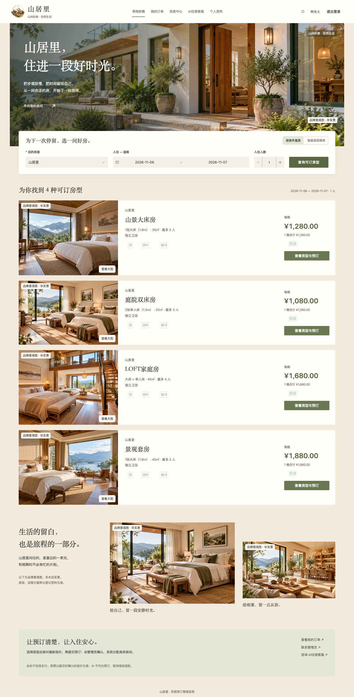 | 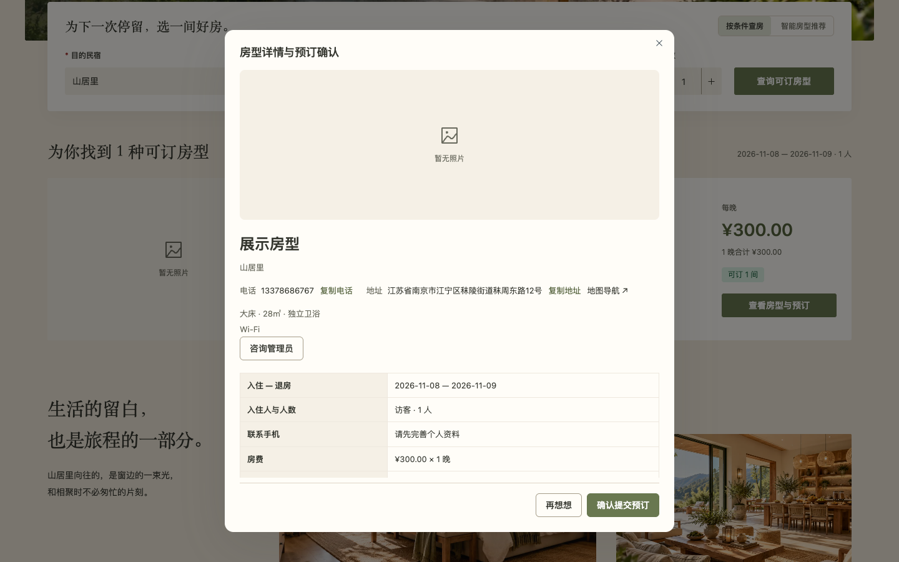 |

### 👑 管理员端

<p align="center">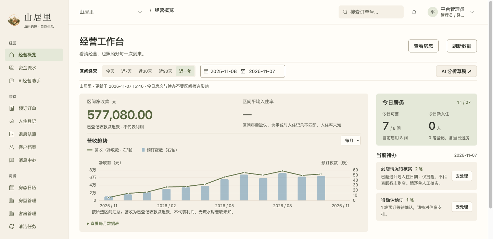</p>

| 预订订单 | 房态日历 |
| --- | --- |
| 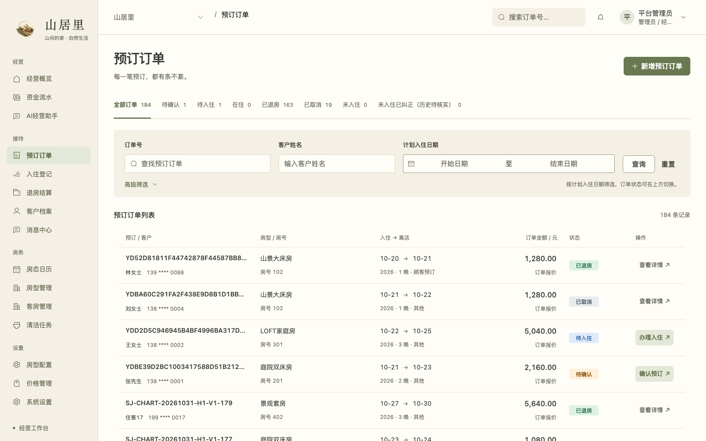 | 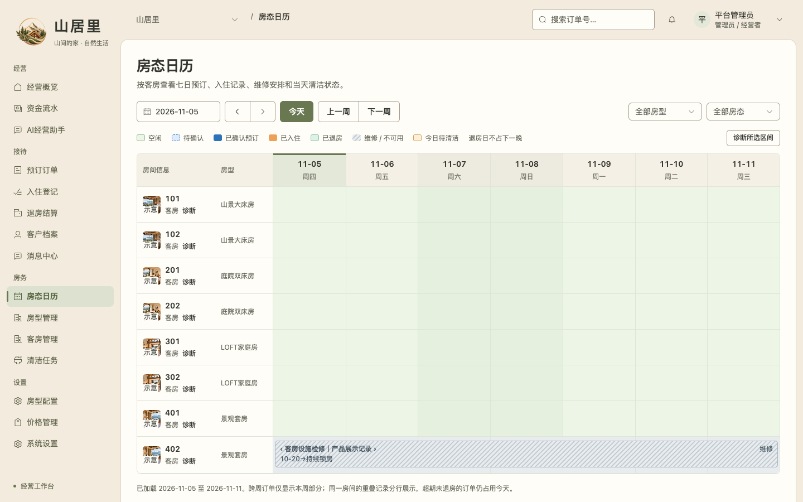 |

| 财务流水 | 知识库管理 |
| --- | --- |
| 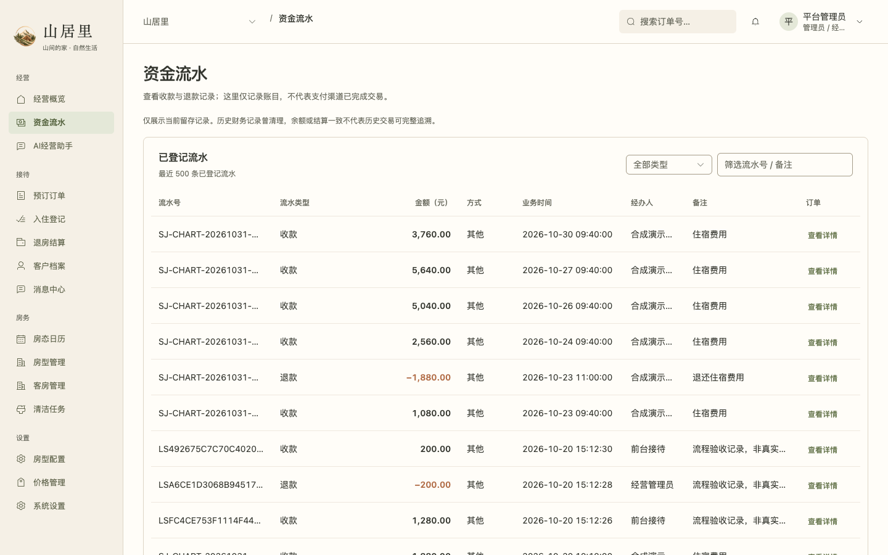 | 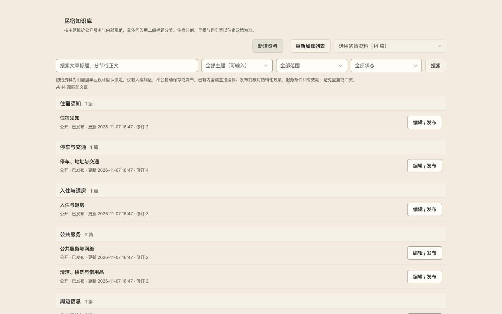 |

### 🧹 保洁端

<p align="center">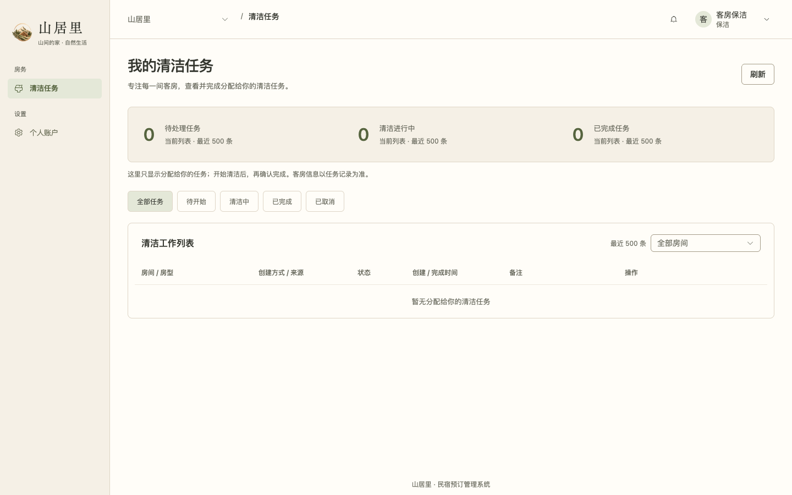</p>

### 🤖 AI 工作区

| AI 新对话入口 | AI 工作区布局 |
| --- | --- |
| 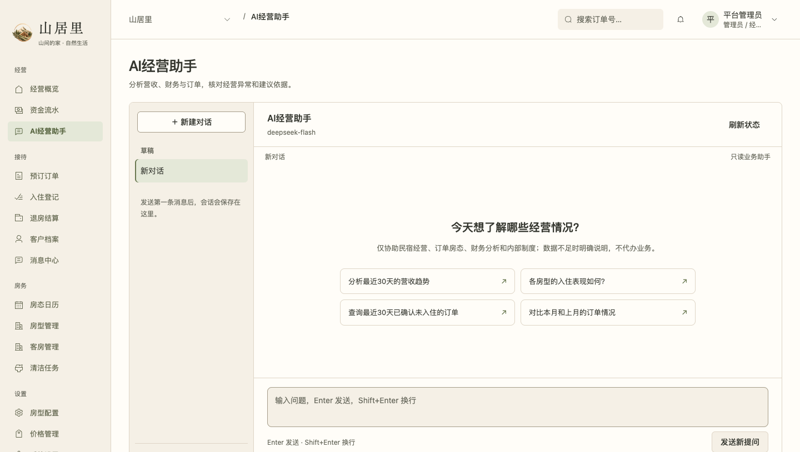 | 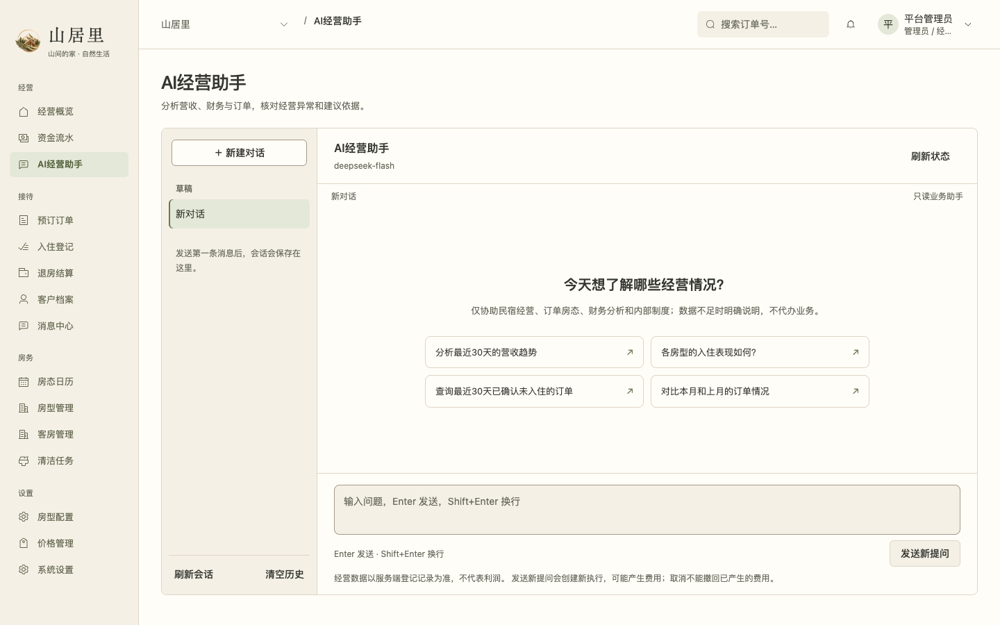 |

图中没有可用于公开展示的真实模型回答记录。AI 供应商调用、回答质量和 SSE/Checkpoint 恢复尚未完成真实模型验收，详见下方状态说明。

## 🏗️ 技术架构

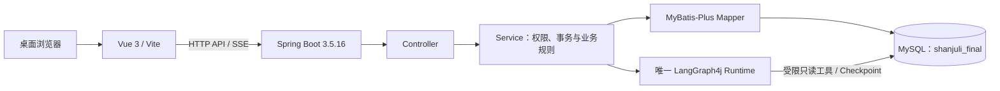

| 层次 | 技术与职责 |
| --- | --- |
| 前端 | Vue 3、Vue Router、Element Plus、ECharts、Axios、Vite；按业务功能组织页面与组件 |
| 后端 | Java 17、Spring Boot 3.5.16、Spring Security、MyBatis-Plus；服务端负责权限、报价、状态和事务 |
| 数据存储 | MySQL；保存民宿、房型客房、订单、入住、资金流水、结算、清洁、维修、消息及知识资料 |
| AI | LangGraph4j 1.8.27；一个 Runtime、一个工具注册入口，住宿客服与经营助手由服务端角色选择场景 |

### 数据与业务边界

- 订单短编号有数据库唯一约束，业务关系继续使用内部 ID 和外键维护。
- 应用启动不自动执行建表或迁移；数据库变更由维护者按文档审查并执行。
- AI 工具受后端角色和对象归属校验，使用知识库解释静态政策；库存、报价、订单和财务事实由现有服务端业务查询提供。
- AI 没有订单、入住、退款、改价或房态写入权限。模型回答不能替代后端业务操作。
- 全系统单民宿，保留三种角色；不支持民宿切换或多租户管理。

## 📁 项目结构

```text
backend/                 Java / Spring Boot 服务端
frontend/                Vue 3 前端
db/                      基础 Schema 与人工审查的迁移 SQL
scripts/                 启动、停止、初始化与构建脚本
docs/                    架构、数据库、验收、维护与历史记录
docs/images/readme/      README 使用的界面截图
start.command            macOS 图形化启动入口
stop.command             macOS 图形化停止入口
```

## 🚀 本地运行

**环境要求：** Java 17、Node.js 22.12+、npm、MySQL 8.0+；macOS 一键启动还需要 Python 3.9+。数据库首次准备和本机配置请先阅读[运行说明](https://github.com/koajsj/minsu/blob/main/RUN_LOCAL.md)，不要在正式或已有业务数据库上执行初始化步骤。

```bash
# 获取完整源码
git clone https://github.com/koajsj/minsu.git
cd minsu

# 恢复前端依赖
npm --prefix frontend ci

# 按 RUN_LOCAL.md 完成本机数据库连接配置后启动
bash scripts/start.sh
```

默认前端地址为 <http://127.0.0.1:5173>。停止本轮启动的服务：

```bash
bash scripts/stop.sh
```

也可在 macOS Finder 中双击 `start.command` 与 `stop.command`。数据库配置放在 Git 忽略的本机 `.local/`；仓库不提供账号密码或数据库凭据。AI 默认关闭，可选配置 `AI_API_KEY` 与 `AI_API_BASE_URL`；模型调用可能计费，需管理员明确配置并确认。

## 🧠 AI 设计

系统提供两个产品入口：**顾客住宿客服**回答住宿相关问题，**管理员经营助手**查询经营数据与内部制度。两者共用唯一 LangGraph4j Runtime、模型配置和 Checkpoint 基础设施，场景由服务端认证角色推导。

- 知识库共 14 篇：11 篇公开资料、3 篇内部制度；顾客只检索公开内容，管理员只检索内部内容。
- 知识检索使用有界关键词匹配；AI 可解释政策，不能把静态知识当作实时库存、报价、订单或支付结果。
- AI 凭据从环境变量读取，不写入源码、README 或浏览器存储。
- 当前未授权调用真实模型，因此 README 不展示虚构回答，也不宣称真实问答已验收。

## 🔎 当前验收状态

截至 **2026-11-09** 的隔离环境验收结论为 **PARTIAL（部分通过）**。正式业务库未用于本轮写入。

| 检查项 | 状态 | 结果摘要 |
| --- | --- | --- |
| Java 编译与后端打包 | PASS | Java 17 编译及 Spring Boot 打包成功 |
| Vue 生产构建 | PASS | Vite 构建成功 |
| 隔离数据库与服务启停 | PASS | 使用独立 MySQL 临时实例完成，结束后已清理 |
| 三角色登录 | PASS | 使用合成账号通过 HTTP 登录、身份查询和退出 |
| 订单至清洁业务链 | PARTIAL | 验证了下单、入住、收款、退房、结算及保洁闭环；并发、异常事务等未覆盖 |
| AI 接口及知识权限 | PARTIAL | 检查了部分知识检索与角色隔离 |
| 真实模型、SSE、Checkpoint 恢复 | NOT_RUN | 未调用模型供应商，未产生模型费用 |
| 浏览器与多尺寸视觉 | PARTIAL | 检查了部分 1440×900 页面；全部页面及 1024/1920 兼容性未通过完整验收 |

构建成功不等于所有功能通过。完整证据、复现范围和未完成事项见[运行验收记录](https://github.com/koajsj/minsu/blob/main/docs/project-runtime-acceptance.md)与[验证状态](https://github.com/koajsj/minsu/blob/main/docs/verification.md)。

## 📚 项目资料

- [完整源码仓库](https://github.com/koajsj/minsu)
- [系统架构](https://github.com/koajsj/minsu/blob/main/docs/architecture.md) · [数据库设计与安装顺序](https://github.com/koajsj/minsu/blob/main/docs/database.md)
- [API 契约](https://github.com/koajsj/minsu/blob/main/API.md) · [本机运行指南](https://github.com/koajsj/minsu/blob/main/RUN_LOCAL.md)
- [维护规范](https://github.com/koajsj/minsu/blob/main/docs/maintenance-guide.md) · [文档导航](https://github.com/koajsj/minsu/blob/main/docs/README.md)

---

<p align="center">✦ 山居里 · 民宿预订与运营管理系统 ✦</p>
